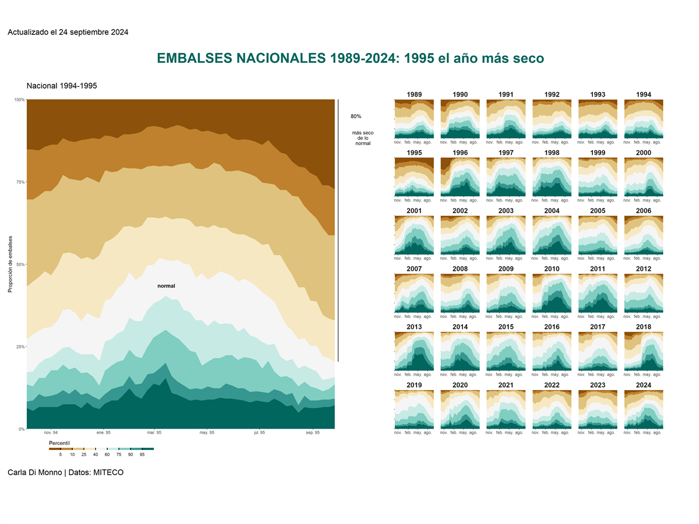
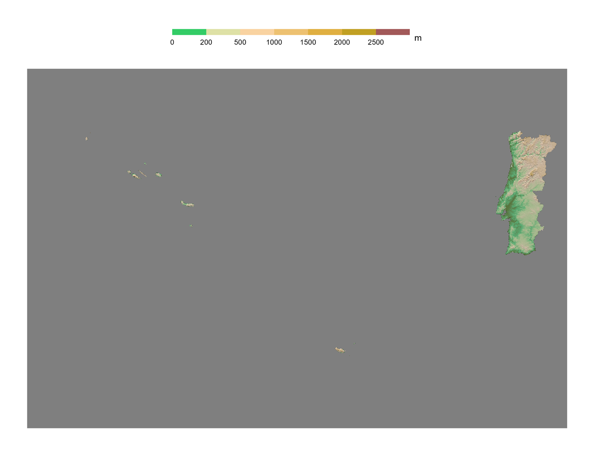

# Visualización de datos y análisis geoespacial con R y Quarto

Flujos reproducibles en **R** y **Quarto** aplicados a hidrología, modelado
del relieve y cartografía temática en Europa. Los informes son autocontenidos
(`embed-resources: true`) y pueden consultarse directamente en el navegador.

**Informes publicados (GitHub Pages)**

- [01 · Anomalías del volumen en embalses de España](https://carladdm.github.io/dataviz-with-R/reports/01-embalses.html)
- [02 · Mapas de relieve de Portugal y camas hospitalarias en Europa](https://carladdm.github.io/dataviz-with-R/reports/02-hillshade.html)

También disponibles en el repositorio:
[HTML 01](docs/reports/01-embalses.html) ·
[HTML 02](docs/reports/02-hillshade.html).

## Vista previa

| 01 · Embalses de España | 02 · Portugal y Europa |
| :---: | :---: |
|  |  |

Las miniaturas se sirven desde `docs/assets/` para que funcionen tanto en la
vista del repositorio como en GitHub Pages.

## Estructura del repositorio

```text
dataviz-with-R/
├── README.md
├── LICENSE               # MIT para código + aviso de datos
├── DESCRIPTION           # dependencias R declaradas
├── _quarto.yml           # configuración común del proyecto
├── R/                    # tema y utilidades reutilizables
│   ├── dataviz_theme.R
│   └── embalses.R
├── scripts/              # descarga y preparación de datos (una sola vez)
│   ├── fetch_embalses.R
│   └── fetch_ag3_data.R
├── data/
│   ├── raw/              # descargas pesadas (ignoradas por Git)
│   └── processed/        # caché ligera de 02-hillshade (versionada)
├── reports/              # fuentes Quarto
│   ├── 01-embalses.qmd
│   └── 02-hillshade.qmd
├── docs/                 # HTML generados (Quarto conserva reports/)
│   ├── assets/           # miniaturas versionadas del README
│   │   ├── 01-embalses-preview.png
│   │   └── 02-hillshade-preview.png
│   └── reports/
│       ├── 01-embalses.html
│       └── 02-hillshade.html
└── outputs/              # PNG exportados (ignorados por Git)
```

La separación entre `scripts/` (descarga), `data/` (datos), `reports/`
(código + narrativa) y `docs/` (resultado) permite que cada informe se
renderice sin repetir descargas ni depender de rutas relativas frágiles.

## Proyectos y competencias demostradas

### 01 · Embalses de España

- **Objetivo:** mostrar la proporción de embalses por percentil de volumen, a
  nivel nacional y por cuenca, usando el año hidrológico (oct–sep), para
  explorar la variabilidad hidrológica y la monitorización de sequías.
- **Técnicas:** `tidyverse`, `janitor`, `patchwork`, ECDF por embalse,
  pequeños múltiples, anotaciones y composición final con `patchwork`.
- **Fuente:** MITECO, histórico semanal de embalses.
- **Nota:** el informe parte de la Actividad Guiada 2 de Dominic Royé
  (@dr_xeo); las ampliaciones propias están señaladas en el documento.

### 02 · Portugal y Europa

- **Objetivo:** generar mapas de relieve (*hillshade*) unidireccional y
  multidireccional de Portugal a partir de datos del SNIG, y cartografiar
  camas hospitalarias NUTS-2 en Europa.
- **Técnicas:** `sf`, `terra`, `tidyterra`, `whitebox`, `ggnewscale`,
  `ggblend`, `eurostat` y `leaflet`.
- **Fuentes:** SNIG/APA (lagos), teselas de elevación vía `elevatr` y
  Eurostat (`hlth_rs_bdsrg`, unidad `P_HTHAB`, año 2013).

## ¿Qué pone en práctica este repositorio?

- **Arquitectura reproducible:** desacoplamiento entre adquisición de datos
  (`scripts/`), funciones auxiliares (`R/`), informes en Quarto (`reports/`)
  y salidas autocontenidas (`docs/`).
- **Criterio analítico y rigor metodológico:** definición explícita del año
  hidrológico (oct–sep), *baseline* histórico fijo, umbral de sequía
  (`< percentil 40`) y cálculo dinámico de métricas narrativas.
- **Visualización estadística y geoespacial:** aplicación de R a datos
  ambientales y territoriales mediante gráficos multi-panel (embalses en
  España), modelado del relieve (*hillshade* en Portugal) y cartografía
  temática europea.

## Cómo ejecutarlo

Requisitos: **R ≥ 4.4**, **Quarto ≥ 1.5** y los paquetes declarados en
`DESCRIPTION`.

```bash
# 0. Clonar el repositorio
git clone https://github.com/carladdm/dataviz-with-R.git
cd dataviz-with-R

# 1. Preparar datos
Rscript scripts/fetch_embalses.R   # MITECO: requiere driver Access ACE 64 bits
# fetch_ag3_data.R solo si quieres refrescar 02-hillshade (datos ya versionados)

# 2. Renderizar informes
quarto render reports/01-embalses.qmd
quarto render reports/02-hillshade.qmd
```

Con `_quarto.yml`, los HTML se escriben en `docs/reports/` (Quarto mantiene la
ruta relativa de `reports/`) y los PNG en `outputs/`.

## Limitaciones y decisiones de reproducibilidad

### Limitaciones

- **Controlador de Access (01-embalses):** `scripts/fetch_embalses.R` abre
  `BD-Embalses.mdb` de MITECO con el controlador ODBC
  `Microsoft Access Driver (*.mdb, *.accdb), 64 bits`. Si no está disponible
  en el sistema operativo o la arquitectura, el script se detiene con un
  mensaje explícito. El HTML publicado en `docs/reports/` corresponde a la
  instantánea 2023-2024 y se puede consultar sin el driver; sí hace falta para
  regenerarlo con el histórico actual.
- **Corte temporal de Eurostat (02-hillshade):** el bloque europeo usa
  `hlth_rs_bdsrg`, unidad `P_HTHAB`, año 2013. Es un corte concreto del
  análisis, no una serie actualizada automáticamente.

### Decisiones de reproducibilidad

- Los datos se descargan **fuera** de los `.qmd`; así los informes no fallan
  por cambios en el nombre de tablas de MITECO ni por falta de red. La caché
  procesada de 02-hillshade está versionada, así que ese informe renderiza
  sin conexión.
- El nombre de la tabla del MDB se detecta por patrón (`Datos Embalses`) y se
  elige la más reciente, en lugar de estar escrito a mano.
- Los percentiles se calculan respecto al histórico completo disponible
  (*baseline* fijo). El criterio de “seco” es `< percentil 40` y está
  documentado en el informe.
- La afirmación “1995 fue el año más seco” se calcula en el propio documento
  y se ordena dinámicamente.
- Los avisos visibles en versiones anteriores se eliminaron corrigiendo su
  causa (rásteres con `geom_spatraster`, `rm()` inexistente, unidades de
  Eurostat y regiones duplicadas).

## Publicación

Los HTML y las miniaturas se sirven desde `docs/` con GitHub Pages
(**Settings → Pages → Deploy from a branch → `main` / `/docs`**). El archivo
`docs/.nojekyll` evita que Jekyll ignore rutas con guion bajo.

## Licencias y atribución

El código y esta documentación están bajo licencia [MIT](LICENSE). Los datos
no están cubiertos por esa licencia: MITECO, SNIG/APA, Eurostat y las teselas
de elevación tienen sus propias condiciones. Las fuentes se citan en cada
informe. El material base de la Actividad Guiada 2 es de Dominic Royé
(@dr_xeo).

© 2024–2026 Carla Di Monno
